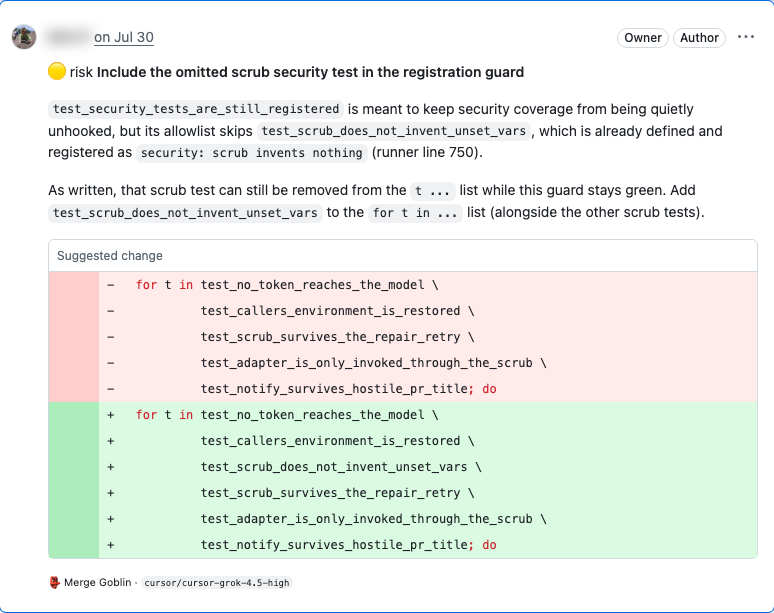

# The Merge Goblin



**He guards the merge button — reviewing the pull requests that ask for your review, on the AI subscription you already pay for.**

He watches for PRs where you're a requested reviewer, reads the repo's *own* review
guidelines, and posts one clearly-labelled automated review with line-anchored comments —
plus a second comment answering "does this actually do what the ticket asked?"

> ### The Goblin refuses the merge.
> `claude/sonnet` · inspected `aa309fb` — 12 files, +1976 −296 against `main`
>
> **🔴 1 blocker · 🟠 2 convention**

He is a native Mac menu bar app and a CLI, running on your Mac, on your schedule, on
your account — nothing is sent anywhere except to the AI CLI you already use.

## Review any PR by number

Press **⌥⌘G**, type `2456`, hit return. That's it — a Goblin goes off, reads the diff and
the repo's own rules, and comes back with a **preview** of the review. You read it, drop or
reword anything you disagree with, and only then does it post. Nothing reaches GitHub until
you say so.

```bash
goblin review 2456                     # preview first (the default for manual reviews)
goblin review acme/widgets#2456        # or a repo-qualified ref, or a full PR URL
goblin review 2456 --focus security    # full · security · summary
goblin review 2456 --post              # skip the preview, post straight away
goblin jobs                            # what is running or waiting for you
goblin cancel <job>
```

A bare number resolves against the repo you are standing in, your only watched repo, or
the last one you used — and asks when it genuinely can't tell. Copy a PR link anywhere and
the menu bar app offers to review it. `goblin://review/acme/widgets/2456` links open the
same preview (they can never post on their own).

---

## Why

Hosted review bots are per-seat and send your code to another vendor. Meanwhile your team
already has Claude, ChatGPT and Cursor seats sitting there. The Goblin drives whichever of those
CLIs you're signed into, so a review costs nothing beyond the subscription you're already
paying for — and switching provider is one click.

- **Your subscription, not an API key.** `claude`, `codex` or `cursor-agent`, whichever is installed.
- **One review, not twenty notifications.** All findings in a single grouped review.
- **Reads your repo's rules.** If the repo has review guidelines, he follows them. No config needed.
- **Never approves, never blocks.** Advisory by default, and it says so in every comment.
- **Never double-reviews.** Several teammates can run him; exactly one reviews each PR.
- **A real off switch.** One toggle in the panel, plus snooze and a daily spend cap.

## Install

Requires macOS 14+, [`gh`](https://cli.github.com), `jq`, and at least one AI CLI you're signed
into (`brew install gh jq` if you need the first two).

**With Homebrew** (recommended):

```bash
brew install --cask Kiril-P/tap/merge-goblin
```

**Or from a release:** download `MergeGoblin-<version>.dmg` from the
[releases page](https://github.com/Kiril-P/merge-goblin/releases), drag **Merge Goblin** to
Applications and open it.

Either way, the first-run walkthrough takes it from there, including the scheduler that
reviews in the background. Builds are not notarised yet, so the first launch is refused:
open **System Settings › Privacy & Security** and click **Open Anyway** next to Merge Goblin
(once per version).

**From source** — builds the app on your machine with the Xcode command line tools:

```bash
git clone https://github.com/Kiril-P/merge-goblin.git && cd merge-goblin
./install.sh
```

The installer asks which account to review as, which subscription to use, and which repo to
watch, then schedules him and installs the app. Re-run it any time to upgrade.

A source install upgrades with those same two commands — `git pull && ./install.sh`. See
[Updating](#updating) for the app from a release.

The installer also drops **Merge Goblin.app** in `~/Applications` — a native SwiftUI menu
bar app that shows what he's doing, which PRs are waiting for you, and lets you change
everything below without touching a terminal. Turn on **Start at login** in Settings and
it's there every morning. The first launch walks you through GitHub, which AI subscription
to use, and which repo to watch.

It's compiled on your machine from `Sources/` with `swift build` (a minute the first time)
and ad-hoc signed, so there's no Gatekeeper prompt. `xcode-select --install` is all it
needs; if the Swift toolchain is missing the installer skips the app and says so, because
the CLI works without it. Needs macOS 14 or later.

```bash
./build.sh                  # build "Merge Goblin.app" into build/ without installing
./build.sh --dev            # a separate "Merge Goblin Dev" that runs next to your real one
goblin app rebuild          # rebuild and swap the installed app (from a git checkout)
goblin app status           # bundle, login item, whether it's running
```

## Updating

Once a day the Goblin checks whether a newer version exists and says so in the popover's
**More** menu, in **Settings > About**, in `goblin doctor` and in the log. Checking never
installs anything. Turn the check off with `goblin config set .update.notify false`.

**The app from a release:** choose **Install update** (More menu, or Settings > About), or
run `goblin update install`. He then:

1. asks GitHub for the latest release of this repo (through your `gh` login) and refuses
   drafts, prereleases, and anything not newer than what you run;
2. downloads `MergeGoblin-<version>.dmg` and `SHA256SUMS` and refuses a DMG that does not
   match its checksum, before even opening it;
3. opens the image read-only and checks that the app inside is Merge Goblin, at that version;
4. if your installed app is signed by a developer team, requires the new one to be signed
   by **the same Team ID** and to pass `codesign --verify --deep --strict`;
5. copies it next to your installed app, swaps the two, deletes the old one and restarts.

Nothing from the download runs until all of that has passed. He waits if a review is running.
If something fails, your installed app is left as it was.

What that does and does not protect against: the checksum catches a corrupted or swapped
download, but whoever can publish a release can publish its checksum too. Proof of *who*
built it comes from the Team ID check, and that only applies once releases are signed with a
Developer ID. An ad-hoc signed app (every build so far) is updated on the checksum alone.

**Installed with Homebrew:** prefer `brew upgrade --cask merge-goblin`, which keeps brew's
record in step. **From source:** `git pull && ./install.sh`, as above.

## Use

Most people only need the menu bar app: **⌥⌘G** to review a PR, the popover to see what's
waiting, **Settings** for everything else — the on/off switch, snooze, which
subscription reviews, model, spend caps, repos, teammates, verdict policy, notifications,
a health check with one-click **Fix**, and your review history. `goblin ui` brings it forward.

The CLI does the same things, if you prefer:

```bash
goblin status                  # where things stand
goblin run --plan              # dry run: show exactly what would be posted, post nothing
goblin run --pr 123            # review one PR right now
goblin doctor                  # diagnose anything odd (--fix repairs the safe stuff)

goblin off / goblin on            # master switch (off survives reboots)
goblin snooze 1h               # temporary quiet
goblin budget 5                # stop after $5/day

goblin provider list           # which subscriptions are ready
goblin provider use codex      # switch who does the reviewing
goblin repos add owner/name    # watch another repo
goblin repo provider owner/name codex gpt-5   # this repo is reviewed by codex (model optional)
goblin repo provider owner/name default       # back to the global provider

goblin update                  # is there a newer Goblin? (tells you; installs nothing)
```

Start with **`goblin run --plan`**. It assembles the real prompt and shows you the diff,
the review rules it found and the lines it can comment on — without calling a model.

## What he posts

A single review, from your account, that cannot be mistaken for you:

> 
>
> ### The Goblin smells an unhandled exception.
> `claude/sonnet` · inspected `fd4e602` — 12 files, +142 −38 against `main`
>
> **🟠 2 convention · 🟡 1 risk**
>
> …summary…
>
> ---
> <sub>👺 posted automatically by the **Merge Goblin** running on @you's machine — this is
> **not** a human review from @you. advisory only: it neither approves nor blocks.</sub>

His verdict line tells you how bad it is before you read a word:

| | |
|---|---|
| no findings | *Suspiciously clean. Proceed.* |
| findings, none blocking | *The Goblin smells an unhandled exception.* |
| a blocker | *The Goblin refuses the merge.* |
| approved (opt-in) | *The Goblin approves this offering.* |

Plus inline comments on the exact lines, and an intent check against the linked issue.

## How it decides what to look for

The Goblin uses **your repo's existing review guidance**, in this order:

1. `.goblin/config.json` → `{"promptPath": "..."}` (`.bob/` still honoured)
2. a review skill under `.agents/skills/*pr-review*/SKILL.md`
3. `.github/PULL_REQUEST_REVIEW.md`, `.github/CODE_REVIEW.md`, `CONTRIBUTING.md`
4. convention sections your guide points at (e.g. a named section of `AGENTS.md`)
5. a built-in general-purpose reviewer prompt

He keeps your rules on *what to flag and how to write*, and ignores anything about *how to
submit* — the Goblin owns posting, so severity and verdict are enforced in code rather than trusted
to the model.

**The rules are read from the base branch, never from the PR.** A pull request that edits
`AGENTS.md` or the review skill can't change how it is graded: the Goblin copies those files out
of `origin/<base>` as git blobs (symlinks ignored) and builds the prompt from that copy.

## How he checks his work

- **He reads the code, not just the diff.** The model gets a read-only checkout of the PR so
  it can confirm a claim against the callers and tests before making it. With Claude that is
  Read, Grep and Glob, confined to that directory — no shell, no network, no writes. Codex
  reads by running shell commands in its own sandbox; see
  [What codex can read](#what-codex-can-read) for exactly how far that is confined. Either
  way it runs from an empty directory with only your own settings, so a PR can't smuggle in
  hooks, MCP servers or an `AGENTS.md` of instructions.
- **Blockers are graded by consequence.** A blocker is something that would cause harm that
  doesn't fix itself, with a trigger he can name. A missing test, missing docs, style or an
  unmeasured performance worry is never one.
- **He reads what people already said.** Comments and reviews from others on the PR go into the
  prompt, so he doesn't repeat them.
- **"Won't fix" means won't fix.** When he re-reviews a PR he reads the replies under his own
  earlier findings. If someone other than him (bots don't count) replies with something like
  *intentional*, *by design*, *won't fix*, *wontfix*, *not a bug*, *false positive*,
  *not an issue* or *working as intended*, or resolves the thread, that finding is marked
  **declined**. A declined finding goes into the prompt's "already posted" list as *declined
  by the author, do not raise again*, and he gets no "no longer flagged" reply. This is a
  keyword heuristic and nothing more. A reply that also agrees ("good catch, will fix",
  "you're right", "not intentional") doesn't count as a decline. He never replies to
  the discussion himself. The patterns live in `share/jq/prior-findings.jq`.
- **A second look before posting.** For reviews that post without a person reading them first
  (the scheduler, `--post`), a skeptical second pass tries to disprove each finding against the
  source, by default with the same provider that wrote the review (set `refute.provider` to
  `auto` or a provider name to have another one check it, which sends the diff to that vendor too).
  It can drop a finding or lower its severity, never raise it, notes in the summary when it
  removed something, and if it fails the findings stand as they were. Previews skip it
  because you are the second look. Costs roughly double; turn it off with `refutePass`.

## Running it as a team

Everyone installs the Goblin and lists the same teammates:

```bash
goblin fleet add alice && goblin fleet add bob && goblin fleet add carol
```

For each PR, `hash(pr + commit) % fleet` picks exactly one owner, so the work — and the token
spend — spreads evenly instead of landing on whoever's laptop is awake. Before reviewing,
the assigned Goblin takes an **atomic lock** (a git ref, which GitHub creates exactly once), so even if
two configs disagree a PR is never reviewed twice. If the owner's machine is asleep, another
Goblin picks it up after a grace period.

`goblin fleet status` (and Settings → Team) shows what each teammate's Goblin has been doing,
read from the claims and review markers it leaves on GitHub: reviewing now, last seen, or no
sign yet. A Goblin with nothing to review leaves no trace, so "no sign" is not "offline".

## Cost and control

Only Claude reports real dollar cost; the subscription CLIs report usage but not money, so
he also caps **reviews per run**. Everything is visible in the panel and `goblin status`.

| control | what it does |
|---|---|
| `goblin off` | stops the scheduler entirely, survives reboot |
| `goblin pause` | temporary; returns at next login |
| `goblin snooze 1h` / `tomorrow` | auto-resumes |
| `goblin budget 5` | pause for the day once today's spend passes $5 |
| `maxReviewsPerRun` | hard stop per cycle, so a backlog can't run away |

### How well is he doing?

`goblin stats` reads back the inline threads he posted (they carry a marker, so only his
are counted) and sorts each into **likely addressed** (resolved, or GitHub marked it
outdated because the code under it changed), **discussed** (still open, someone replied)
or **silent**. `--json`, `--days N` (default 30) and `--refresh` are available; the
answer is cached for six hours. The popover's Recent tab and Settings → About show it too.
`goblin stats --by severity` or `--by repo` breaks the same numbers into one row per
severity or per repo (works with `--json` too).

"Outdated" can also come from an unrelated edit, and a silent finding isn't necessarily
wrong, so treat it as a trend line: if the rate drops after you change the prompt or the
rules, the change probably hurt. Findings that couldn't be pinned to a diff line ride in
the review body and aren't counted.

## Configuration

`~/.goblin/config.json` — edit with `goblin config set <jq-path> <value>`, `goblin config edit`, or the panel.

| key | default | |
|---|---|---|
| `provider` | `claude` | `claude` · `codex` · `cursor` |
| `providerFallback` | `[]` | try these if the main one is out of quota |
| `verdictMode` | `comment` | `comment` · `request-changes` · `full` |
| `allowApprove` | `false` | second opt-in required before he can ever approve |
| `budgetCapUsd` | `10` | 0 = unlimited |
| `maxReviewsPerRun` | `5` | |
| `maxFindings` | `25` | |
| `autoPost` | `always` | what the scheduler does with a finished review: `always` posts, `safe` holds anything with a blocker or rated high-risk, `never` holds everything for you to post from Ready to read |
| `reviewMine` | `off` | review every push to PRs **you** opened: `hold` keeps each review private in Ready to read (nothing on GitHub), `post` posts it as a comment review |
| `reviewMineDrafts` | `false` | with `reviewMine` on, review your draft PRs too |
| `refutePass` | `true` | second, skeptical pass before an unattended review posts |
| `gitTimeoutSecs` | `120` | cap on every clone / fetch the engine runs |
| `fleet` | `[]` | teammates also running the Goblin |
| `intervalSeconds` | `300` | re-run `install.sh` after changing |
| `skip.bots` | `true` | skip PRs opened by a dependency bot (Settings → Behaviour) |
| `skip.botLogins` | dependabot, renovate, snyk-bot, … | the logins that count as bots (`[bot]` / `app/` stripped) |
| `skip.docsOnly` | `false` | skip PRs that only touch docs (Settings → Behaviour) |
| `skip.docsPaths` | `*.md`, `*.mdx`, `*.markdown`, `*.rst`, `docs/**` | what counts as docs |
| `skip.paths` | lockfiles, `*.min.js`, maps, snapshots, generated code, `dist/`, `vendor/` | skip a PR when **every** file matches |
| `repos[].provider` / `.model` | unset | who reviews this one repo (`goblin repo provider`, or the Repos pane) |
| `repos[].skip` | unset | a partial `skip` object that overrides the global one for this repo |

### What he leaves alone

Before any model runs, a PR is checked against the `skip` rules:

- **Dependency bots.** The author is one of `skip.botLogins`. Set `skip.bots` to `false` to
  review them anyway.
- **Noise only.** Every changed file matches `skip.paths`. Globs: `*` stays inside one
  directory, `**` crosses directories, and a pattern without a `/` matches the file name in
  any directory. A PR that touches a lockfile and real code is still reviewed.
- **Docs only** (off by default). Every file is docs (`skip.docsPaths`) or noise, and at least one
  is docs.

The scheduler skips quietly. You see `skipped: …` with the reason in the log and the
history, and the PR isn't picked up again at the same commit. A manual review comes back as a
**skipped** job that says why. Pass `--force` to review the PR anyway. If the file list
can't be fetched, the PR is reviewed rather than skipped.

The two toggles are in Settings → Behaviour. Paths, bot logins and per-repo overrides are
config-only. For example, to review Renovate PRs and skip docs-only PRs in one repo:

```json
"repos": [
  { "slug": "acme/api", "enabled": true,
    "provider": "codex", "model": "gpt-5",
    "skip": { "bots": false, "docsOnly": true, "paths": ["*.lock", "openapi/generated/**"] } }
]
```

A per-repo object is merged key by key over the global one, and arrays such as `paths`
replace the global list. A repo's `provider`/`model` applies to scheduled and manual
reviews alike. `goblin review --provider/--model` still wins for that one review. If the
repo's provider isn't ready, he falls back to the global one and logs it.

### What codex can read

Codex reads code by running shell commands in its own macOS sandbox. `--sandbox read-only`
alone blocks writes and network, **but those commands can still read the whole disk**. In
testing, `ls ~/.ssh` and a file under `$HOME` both came straight back. So when the installed
codex supports permission profiles, the Goblin passes one for each review
(`default_permissions="goblin"`).

**Confined:** commands the model runs can read the PR checkout and nothing else of yours.
That excludes `$HOME`, `~/.ssh`, `~/.goblin`, the other clones, `/tmp` and `$TMPDIR`. They
can't write anywhere and have no network. They start in an empty directory, and the PR's
`AGENTS.md` isn't loaded (`project_doc_max_bytes=0`).

**Not confined:**

- System files that codex's `:minimal` set keeps readable so a shell can start (`/bin`,
  `/usr`, `/System`, `/etc`, …). None of them hold your data.
- Environment variables the shell inherits. The Goblin removes `GH_TOKEN`, `GITHUB_TOKEN`
  and `GH_ENTERPRISE_TOKEN` first. Any other secret in the Goblin's environment is visible
  to those commands.
- The codex process itself, which reads its own login in `~/.codex` and talks to OpenAI.
  Only the commands the model runs are sandboxed.

**Verified** with codex-cli 0.163.0-alpha.10.2:

- Under the profile, `codex sandbox` read a file in the checkout (also when the checkout sat
  under `$HOME` or `/tmp`).
- It was refused a file in a sibling directory under `$HOME`, `~/.ssh`, a file in `/tmp` and
  one in `$TMPDIR`, a write, and `curl` to a public host.
- A real `codex exec` review under the same flags got the same results: the model read the
  checkout and was refused everything else on the list.

Before each review the Goblin checks this again: it asks the sandbox to read one file inside
a scratch grant and one outside it. If that check fails (for example, an older codex without
profiles), the review falls back to `--sandbox read-only` and the log says reads are
**NOT confined**. Update codex to fix it.

## How it works

```
launchd ──▶ goblin run ──▶ pick PRs ──▶ assign ──▶ claim (git ref)
                                                    │
                       repo's review rules ─┐       ▼
                       annotated diff ──────┼──▶ your AI CLI ──▶ findings JSON
                       linked issue ────────┘                        │
                                                                     ▼
                                          validate ▸ drop unpostable lines ▸
                                          one grouped review + intent comment
```

The model never touches GitHub. It can read the checkout (nothing writable, no network; see
[What codex can read](#what-codex-can-read)) and returns JSON. The Goblin does the posting. That's what makes providers swappable and the verdict safe.

State lives in `~/.goblin/`: `config.json`, `events.jsonl` (history and spend), `ledger`
(what's been reviewed), `repos/` (scratch clones), `goblin.log`.

## Uninstall

```bash
./uninstall.sh            # send him home, keep history
./uninstall.sh --purge    # remove everything
```

## Notes

- **macOS only** (uses `launchd`; the app needs macOS 14+). The engine is Bash 3.2 + `jq` +
  `gh`; the app is Swift with no third-party packages.
- **He posts under your GitHub account.** Subscription CLIs have no bot identity, so every
  artifact is labelled and disclaims being your review. He never approves or requests
  changes unless you explicitly opt in twice.
- **On subscription terms:** he drives interactive AI CLIs non-interactively. That may sit
  outside what those plans intend, and heavy use can hit rate limits. Check your plan; use
  it deliberately.
- Reviews are only as good as the model and the repo's guidelines. Read the first few and
  tune `maxFindings` / the repo prompt.

## Development

```bash
./tests/run.sh            # offline: fake gh/claude/launchctl, no network, no cost
swift test                # the app's own tests: PR refs, the command allowlist, job state
bash -n lib/*.sh bin/goblin
./build.sh --dev          # build the app; scripts/demo-home.sh makes a throwaway home to point it at
GOBLIN_HOME=/tmp/gtest ./install.sh --non-interactive --no-agent --no-menu --home /tmp/gtest
```

The app never builds a shell command. Everything it can ask the engine for is a case of the
closed `Command` enum in `Sources/Goblin/Core/Command.swift`, which builds the argv and
refuses anything it did not name — so there is one implementation of every action, and no
free-form string can become a flag. There is deliberately no "set any config key" case.

`Sources/Goblin/Core` has no AppKit in it and is what the tests import; `App/` owns state
and windows; `Views/` is SwiftUI. Run `GoblinBar --snapshot <dir>` against a demo home to render
every screen to PNG without a window server.

Adding a provider is one file in `lib/providers/` implementing `probe` and `review`.
Renaming him is one file: `lib/brand.sh`.

### Releasing

`.github/workflows/release.yml` does the building, signing, notarising and publishing when a
`v*` tag is pushed. What only the maintainer can do:

**Once:**

1. **Developer ID certificate.** Join the Apple Developer Program, create a *Developer ID
   Application* certificate (Xcode > Settings > Accounts > Manage Certificates), export it as
   a password-protected `.p12`, and add two repository secrets: `MACOS_CERT_P12`
   (`base64 -i cert.p12`) and `MACOS_CERT_PASSWORD`. An *Apple Development* certificate will
   not do: it cannot be notarised.
2. **Notary credentials.** Create an app-specific password at appleid.apple.com and add
   `APPLE_ID`, `APPLE_TEAM_ID` and `APPLE_APP_PASSWORD`. Locally,
   `xcrun notarytool store-credentials <name>` and `NOTARY_PROFILE=<name> scripts/notarize.sh`
   does the same.
3. **Tap.** `Kiril-P/homebrew-tap` (exists) holds `Casks/merge-goblin.rb`.

Without the secrets the workflow still publishes, unsigned and un-notarised.

**Every release:**

1. Bump `GOBLIN_VERSION` in `lib/brand.sh` (the only place it is written) and add a
   `## <version>` section to `CHANGELOG.md`. The test suite fails if either is missing.
2. `./tests/run.sh && swift test`.
3. `git tag v<version> && git push origin v<version>`. The workflow refuses a tag that
   disagrees with `lib/brand.sh`.
4. Check the release has `MergeGoblin-<version>.dmg`, `SHA256SUMS` and `merge-goblin.rb`.
   **Never publish one without `SHA256SUMS`**: the in-app updater refuses it.
5. `scripts/update-tap.sh` copies the release's `merge-goblin.rb` into the tap and pushes.
6. Download the DMG and run `shasum -a 256 -c SHA256SUMS`; for a signed release also
   `xcrun stapler validate` and `spctl -a -vv -t open --context context:primary-signature` on it. Then install the
   previous version and use **Install update** to make sure the update path works.

The first Developer ID release is accepted by existing ad-hoc installs on its checksum alone.
From then on the Team ID is pinned: an update signed by anyone else, or not signed, is
refused. Keep the certificate's team the same across releases.

MIT licensed.
